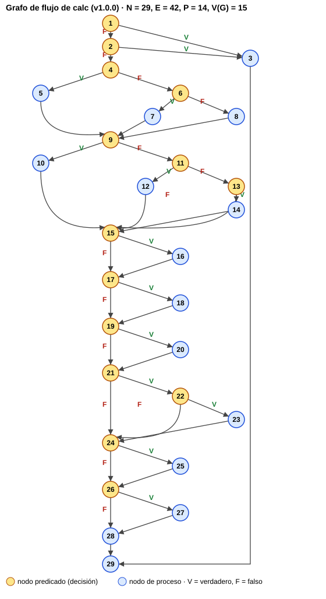

# Parte 4 · Caja blanca

## 4.1 Grafo de flujo de `calc` (código heredado v1.0.0)

La condición compuesta `p <= 0 || p > 50` se separa en dos nodos predicado (1 y 2), como se hace en un grafo de flujo.

| Nodo | Línea(s) de `envios.js` v1.0.0 | Contenido | Tipo |
|---|---|---|---|
| 1 | 13 | `p <= 0` | predicado |
| 2 | 13 | `p > 50` | predicado |
| 3 | 14 | `throw new Error("peso invalido")` | proceso |
| 4 | 16 | `p <= CONFIG.L1` | predicado |
| 5 | 17 | `t = 6000` | proceso |
| 6 | 18 | `p <= CONFIG.L2` | predicado |
| 7 | 19 | `t = 9000` | proceso |
| 8 | 21 | `t = 9000 + (p - L2) * 800` | proceso |
| 9 | 23 | `z == "urbana"` | predicado |
| 10 | 24 | `t = t` | proceso |
| 11 | 25 | `z == "rural"` | predicado |
| 12 | 26 | recargo rural | proceso |
| 13 | 27 | `z == "nacional"` | predicado |
| 14 | 28 | recargo nacional | proceso |
| 15 | 31 | `d > 6` | predicado |
| 16 | 32 | `t + RECARGO_FINDE` | proceso |
| 17 | 34 | `c == "frecuente"` | predicado |
| 18 | 35 | descuento 5 % | proceso |
| 19 | 37 | `c == "vip"` | predicado |
| 20 | 38 | descuento VIP | proceso |
| 21 | 40 | `cup != null` | predicado |
| 22 | 41 | `cup == "ENVIO10"` | predicado |
| 23 | 42 | descuento 10 % | proceso |
| 24 | 45 | `t < 5000` | predicado |
| 25 | 46 | `t = 5000` | proceso |
| 26 | 48 | `flag` | predicado |
| 27 | 49 | `console.log` | proceso |
| 28 | 51 | `return Math.trunc(t / 100) * 100` | proceso |
| 29 | — | fin (salida única) | fin |

## 4.2 Complejidad ciclomática de tres formas

1. **Con aristas y nodos:** E = 42 aristas, N = 29 nodos → V(G) = E − N + 2 = 42 − 29 + 2 = **15**
2. **Con nodos predicado:** P = 14 (nodos 1, 2, 4, 6, 9, 11, 13, 15, 17, 19, 21, 22, 24, 26) → V(G) = P + 1 = **15**
3. **Con regiones:** el grafo es plano y tiene 14 regiones cerradas más la región exterior → R = **15**
   (cada decisión binaria cierra una región: 2 por la validación del peso, 2 por los tramos, 3 por las zonas, 1 por el fin de semana,
   2 por los clientes, 2 por el cupón, 1 por el mínimo y 1 por el flag).

**V(G) = 15** → se necesitan como máximo 15 caminos independientes, y como mínimo 15 casos para cubrirlos.
(Si la condición compuesta del peso se contara como un solo predicado, V(G) = 14; se usa 15 porque el grafo separa las condiciones.)

## 4.3 Caminos independientes y casos de prueba

Camino base: 1-2-4-6-7-9-10-15-17-19-21-24-26-28-29. Cada camino siguiente agrega al menos una arista nueva.

| Camino | Secuencia de nodos (arista nueva en negrita) | Caso | Entradas | Esperado (especificación) |
|---|---|---|---|---|
| C1 | 1-2-4-6-7-9-10-15-17-19-21-24-26-28-29 | CB01 | (5, urbana, normal, 1) | $9.000 |
| C2 | **1-3**-29 | CB02 | (0, urbana, normal, 1) | error |
| C3 | 1-**2-3**-29 | CB03 | (51, urbana, normal, 1) | error |
| C4 | 1-2-**4-5-9**-10-15-…-29 | CB04 | (2, urbana, normal, 1) | $6.000 |
| C5 | 1-2-4-**6-8-9**-10-15-…-29 | CB05 | (12, urbana, normal, 1) | $10.600 |
| C6 | …-9-**11-12-15**-17-…-29 | CB06 | (5, rural, normal, 1) | $10.800 |
| C7 | …-9-11-**13-14-15**-…-29 | CB07 | (5, nacional, normal, 1) | $13.500 |
| C8 | …-9-11-13-**15** (ninguna zona) | CB08 | (5, marte, normal, 1) | error (R2) |
| C9 | …-**15-16-17**-…-29 | CB09 | (5, urbana, normal, 7) | $11.000 |
| C10 | …-**17-18-19**-…-29 | CB10 | (5, urbana, frecuente, 1) | $8.600 |
| C11 | …-**19-20-21**-…-29 | CB11 | (5, urbana, vip, 1) | $7.700 |
| C12 | …-**21-22-23-24**-…-29 | CB12 | (5, urbana, normal, 1, ENVIO10) | $8.100 |
| C13 | …-21-**22-24**-…-29 | CB13 | (5, urbana, normal, 1, XYZ) | error (R7) |
| C14 | …-**24-25-26**-…-29 | CB14 | (1, urbana, vip, 1, ENVIO10) | $5.000 |
| C15 | …-**26-27-28**-29 | CB15 | (5, urbana, normal, 1, null, true) | imprime "costo: 9000" y retorna $9.000 |

Nota: C8 y C13 existen en el código heredado (la zona o el cupón no coinciden y el flujo continúa), pero la especificación
pide un error. Por eso CB08 y CB13 fallan contra la v1.0.0 y revelan DEF-04 y DEF-03.

## 4.4 Cobertura de sentencias y de ramas

- **Cobertura de sentencias (100 %):** basta con un subconjunto que ejecute todas las sentencias:
  CB02 (throw), CB04 (t = 6000), CB01 (t = 9000), CB05 (tramo 3), CB06 (rural), CB07 (nacional), CB09 (fin de semana),
  CB10 (frecuente), CB11 (VIP), CB12 (cupón), CB14 (t = 5000) y CB15 (console.log). Esos **12 casos** cubren todas las sentencias.
- **Cobertura de ramas (100 %):** además de los anteriores se necesita que cada decisión tome su salida falsa y verdadera:
  CB03 (rama verdadera de `p > 50`), CB08 (salida falsa de `z == "nacional"`) y CB13 (salida falsa de `cup == "ENVIO10"`).
  Con los **15 casos CB01–CB15** se recorren las 28 ramas (14 decisiones × 2).
- **Medición real con Jest** sobre `envios.js` v1.0.0 (toda la suite, 51 casos): **100 % de sentencias, 100 % de ramas,
  100 % de funciones y 100 % de líneas**: 29/29 sentencias y 30/30 ramas; istanbul cuenta 30 ramas porque, además de las 28
  salidas de las decisiones, incluye los dos lados del operador `||` (ver `evidencias/01_heredado.png`). Que la cobertura sea del 100 % y aun así fallen 21 pruebas
  muestra que la cobertura no garantiza la corrección: los defectos son de lógica contra la especificación.
