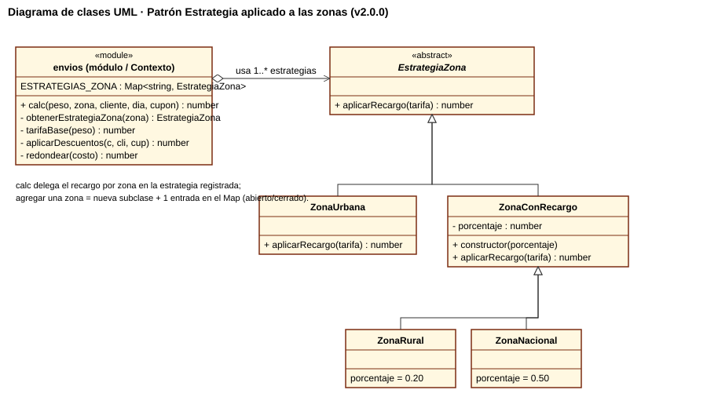

# Parte 6 · Mantenimiento y refactorización

## 6.1 Malos olores (code smells) del código heredado

Las líneas se refieren a `envios.js` v1.0.0 (traducción línea a línea de `envios.py`).

| # | Mal olor (nombre técnico) | Línea(s) | Evidencia | Deuda técnica que genera |
|---|---|---|---|---|
| 1 | **Números mágicos** (*Magic Numbers*) | 13 (`0`, `50`), 17 (`6000`), 19 y 21 (`9000`, `800`), 31 (`6`), 35 (`0.05`), 42 (`0.1`), 45–46 (`5000`), 51 (`100`) | Valores del negocio escritos como literales | Cambiar una tarifa obliga a buscar el número en todo el código; un cambio olvidado deja precios inconsistentes. |
| 2 | **Método largo / función que hace demasiado** (*Long Method*, violación de responsabilidad única) | 11–52 | `calc` valida, calcula la tarifa, aplica zona, fin de semana, descuentos, mínimo, redondeo e imprime | No se puede probar cada regla por separado; V(G) = 15 hace difícil entenderla y modificarla sin romper otra regla. |
| 3 | **Argumento bandera** (*Flag Argument*) | 11 (`flag = false`), 48–50 | Un booleano cambia el comportamiento (imprimir o no) | Mezcla cálculo con entrada/salida, agrega un camino más que probar y ensucia la interfaz pública. |
| 4 | **Nombres misteriosos** (*Mysterious Name*) | 11 (`p, z, c, d, cup`), 12 (`t`) | Una letra por parámetro | Hay que leer todo el cuerpo para saber qué es cada variable; sube el costo de incorporar a un nuevo desarrollador. |
| 5 | **Código muerto / asignación inútil** (*Dead Code*, *self-assignment*) | 24 `t = t` | La rama urbana no hace nada | Confunde al lector (¿falta algo?) y agrega una rama sin valor. |
| 6 | **Condicionales repetidos sobre un tipo** (*Repeated Switches*) | 23–29 (zonas), 34–39 (clientes) | Cadenas `if / else if` sobre una cadena de texto | Agregar una zona o un tipo de cliente obliga a modificar `calc` (viola abierto/cerrado), justo lo que pide la Parte 8. |
| 7 | **Datos globales mutables** (*Global Data*) | 2–9 `CONFIG` | Objeto global modificable desde cualquier módulo | Cualquier código puede cambiar las tarifas en tiempo de ejecución; los errores son difíciles de rastrear. |
| 8 | **Configuración inconsistente / conocimiento duplicado** | 2–9 frente a 13, 35, 42, 45 | Unos parámetros están en `CONFIG` y otros están quemados (`50`, `0.05`, `0.1`, `5000`) | No hay una fuente única de verdad para las reglas del negocio. |
| 9 | **Comentario desodorante** (*Comments*) | 30 `// fin de semana` | El comentario explica `d > 6` en vez de usar un nombre | El comentario no se mantiene y además miente: `d > 6` excluye el sábado (DEF-02). |
| 10 | **Condicional anidado** (*Nested Conditional*) y comparación laxa | 40–44 (`cup != null` + `cup == "ENVIO10"`), `==` en 23–41 | Dos niveles para validar el cupón y comparaciones con conversión implícita | Oculta la rama faltante del cupón inválido (DEF-03); `==` permite coincidencias inesperadas por conversión de tipos. |

## 6.2 Clasificación de los cambios (ISO/IEC 14764)

| Cambio | Rama | Tipo de mantenimiento | Justificación |
|---|---|---|---|
| DEF-01 a DEF-07 | `fix/DEF-01` … `fix/DEF-07` | **Correctivo** | Corrigen fallas frente a la especificación. |
| Reemplazar números mágicos por constantes con nombre | `refactor/estrategia` | **Preventivo** | No cambia el comportamiento; reduce el riesgo de fallas futuras al modificar tarifas. |
| Extraer funciones (`validarPeso`, `tarifaBase`, `aplicarDescuentos`, `redondear`, …) | `refactor/estrategia` | **Preventivo** | Mejora la mantenibilidad y la capacidad de prueba (V(G) por función ≤ 4). |
| Patrón Estrategia en zonas | `refactor/estrategia` | **Preventivo** | Prepara el código para nuevas zonas sin modificar `calc` (abierto/cerrado). |
| Eliminar el argumento `flag` y el `console.log` | `refactor/estrategia` | **Perfectivo** | Mejora la interfaz y separa el cálculo de la presentación. |
| Validar que el peso sea numérico | `refactor/estrategia` | **Preventivo** | Evita que `"5"` (texto) se acepte por la conversión implícita de JavaScript. |
| Solicitud de cambio CR-01: zona insular | `feat/zona-insular` | **Perfectivo** | Nueva funcionalidad pedida por el negocio (ver Parte 8). |
| (Ninguno) | — | Adaptativo | No hubo cambios de plataforma ni de entorno. La traducción a JavaScript no se clasifica como mantenimiento del producto, porque conserva la lógica original. |

## 6.3 Refactorización realizada

1. **Constantes con nombre:** `PESO_MAXIMO_KG`, `LIMITE_TRAMO_1_KG`, `LIMITE_TRAMO_2_KG`, `TARIFA_TRAMO_1`, `TARIFA_TRAMO_2`,
   `VALOR_KG_ADICIONAL`, `RECARGO_RURAL`, `RECARGO_NACIONAL`, `RECARGO_FIN_DE_SEMANA`, `SABADO`, `DESCUENTOS_CLIENTE`,
   `CUPONES`, `COSTO_MINIMO`, `MULTIPLO_REDONDEO`. El objeto global mutable `CONFIG` desaparece; las tablas se congelan con `Object.freeze`.
2. **Funciones extraídas:** `validarPeso`, `validarDia`, `obtenerEstrategiaZona`, `tarifaBase`, `esFinDeSemana`,
   `porcentajeCliente`, `porcentajeCupon`, `aplicarDescuentos`, `redondear`. Ahora `calc` solo coordina (V(G) = 2).
3. **Se eliminó `flag`:** `calc(peso, zona, cliente, dia, cupon = null)`. Es un cambio incompatible de la interfaz → **v2.0.0**.
4. **Patrón Estrategia en las zonas:** `EstrategiaZona` (abstracta) → `ZonaUrbana`, `ZonaConRecargo` → `ZonaRural`, `ZonaNacional`.
   `calc` obtiene la estrategia desde el registro `ESTRATEGIAS_ZONA` y le delega el recargo. Una zona desconocida produce un error.

## 6.4 Corrección y regresión

- Cada defecto se corrigió en su propia rama (`fix/DEF-01` … `fix/DEF-07`) y se integró con `merge --no-ff`.
  Después de cada integración se ejecutó toda la suite:

| Después de | Pasan / total |
|---|---|
| v1.0.0 (heredado) | 30 / 51 |
| DEF-01 | 32 / 51 |
| DEF-02 | 34 / 51 |
| DEF-03 | 36 / 51 |
| DEF-04 | 38 / 51 |
| DEF-05 | 40 / 51 |
| DEF-06 | 50 / 51 |
| DEF-07 → **v1.0.1** | **51 / 51** ✅ |
| Refactorización → **v2.0.0** | **62 / 62** ✅ (51 originales + 11 unitarias) |

- Las **mismas** 51 pruebas se volvieron a ejecutar sin cambios después de la refactorización. La única excepción es CB15, que probaba
  el argumento `flag`: como ese argumento se eliminó a propósito (cambio incompatible), CB15 ahora verifica que un 6.º argumento
  ya no imprime nada. Capturas: `evidencias/02_corregido.png` y `evidencias/03_refactor.png`.
